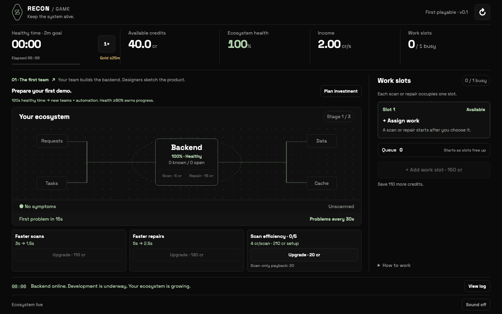
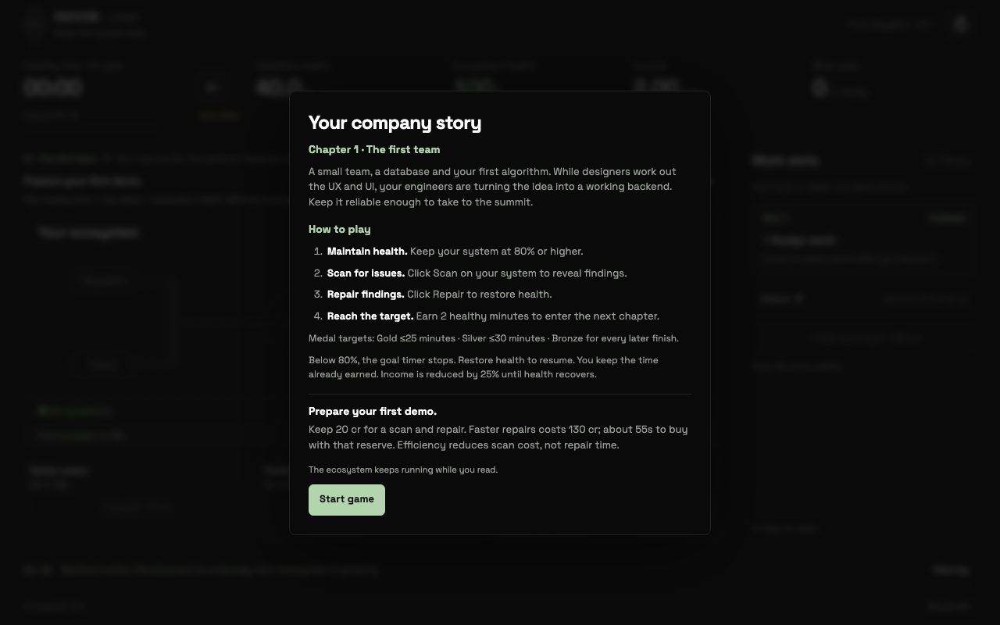

# Recon design system in Recon Game

Updated: 2026-10-12 · D89

## Source review

The user supplied `recon-design-system.zip`, a portable source extraction from Recon develop revision `ead707c89f2f616abe7d4c24f088f005a05d025f`, dated 2026-10-12. Its foundations, component documentation, CSS tokens, button, pill, card, dialog, icons and application layout informed this update.

The archive is a source extract, not a published component dependency. Some components reference Nx aliases, translation initialization and a Tailwind/Radix environment. Importing the entire package would add unrelated infrastructure to this standalone game. The implementation therefore adapts its visual contract to the game's existing native controls and dialogs.

## Applied foundations

| Source | Game implementation |
| --- | --- |
| `src/styles/globals.css` dark palette | Exact neutral, brand, warning, caution and destructive OKLCH values in `src/design-tokens.css` |
| Space Grotesk 400/700 | Body, headings and controls; self-hosted Fontsource 5.3.0 packages |
| Space Mono 400 | Timestamps, map zoom, finding numbers and compact award metadata |
| Semantic background/card/muted/border/primary/ring | Replaces the previous scattered green surface colors throughout `src/styles.css` |
| Button default/outline/ghost states | Primary chapter action, neutral secondary controls, quiet navigation, disabled treatment and green keyboard focus ring |
| Card, dialog and pill geometry | 8px card/dialog corners, 6px controls, rounded status labels, neutral dialog surface |
| `src/components/icons/SumZeroLogo.svg` | Supplied brand mark in `src/ReconMark.tsx`, with Recon / Game lettering and the existing three-click debug action |
| Brand navigation typography | Uppercase header label with 0.08em tracking |

The game retains its dark appearance; this change does not introduce a theme switch. Green signals healthy/active states. Amber indicates degradation and red indicates system failure. Map lines, subtle tinted states and overlays use explicit extensions derived from the supplied palette. Gold/silver/bronze are separate game award tokens.

## Game adaptations

Compact game spacing and responsive geometry take precedence over the source card's generic 24px padding. The ecosystem stays central, work slots stay on the right on desktop, and the existing phone view switch remains. Automated scans stay above automated repairs at every viewport. Existing pan/zoom, focus restoration, repair-list ordering, native dialog behavior and reduced-motion handling remain intact. No hover information panels were imported.

This is a visual update. Engine, costs, pacing, health gates, medals, queue rules, fixed-order finding distribution and no-persistence behavior are unchanged. Fonts are bundled by Vite beneath `/recon-game/assets/`; there is no external font service. The supplied fonts remain under their package-provided SIL Open Font Licenses; copies in `public/licenses/` ship with the site. Only the brand asset and relevant style foundations were adapted; the source app and unused assets are not vendored.

## Verification

- All 70 engine/map/story tests pass; production build with `/recon-game/` base passes.
- Chromium automation geometry: 1440×1000, 1280×800, 1024×768, 800×700 and 390×844; stacked controls, focused-card bounds, zoomed states and page overflow checks pass.
- Chapter/story journey: introductions, guidance, debug checkpoints, focus restoration and victory; desktop/phone bounds pass.
- Full game browser journey: scans, repairs, retained findings list, five work slots/FIFO queue, scope prices, automation, 100-repository canvas gestures, victory and no-storage guards pass.
- Completion journey: near-goal cue, full clock, delayed chapter introduction, continued simulation and reduced motion pass.
- Production-path smoke: three font faces load from the same origin under `/recon-game/assets/`, initial reading is free, paid scan/repair restores health, and desktop/phone bounds pass without browser errors.
- Desktop and phone screenshots inspected. These are Chromium checks, not a full accessibility audit or Safari/physical-trackpad certification.

Run browser scripts with `PLAYWRIGHT_MODULE_DIR` pointing to an installed Playwright module directory. Local preview: `npm run build -- --base=/recon-game/` then `npm run preview -- --base=/recon-game/ --port 4174`. `tests/published-browser.mjs` defaults to that preview; `GAME_URL` overrides it. Other browser scripts default to the development server on port 5173. Do not change runtime files while browser journeys run.

## Review previews

[Phone ecosystem preview](docs/design-preview/ecosystem-phone.png)

## Desktop readability follow-up (D94–D96)

Desktop/laptop is the supported product scope; no further mobile validation is required. Original font sizes now use a shared 1.2 scale; chapter/story dialogs override it to 1.5, rather than multiplying both scales. Action buttons share the Start game primary sage fill and dark foreground (D96), with the same hover treatment. Chapter navigation, work-slot cards, map labels and the Recon logo retain their original colours. Repository headings are non-interactive status summaries with health-based colours (D98). Disabled controls remain muted. Blue and stronger-border experiments were rejected and removed.
